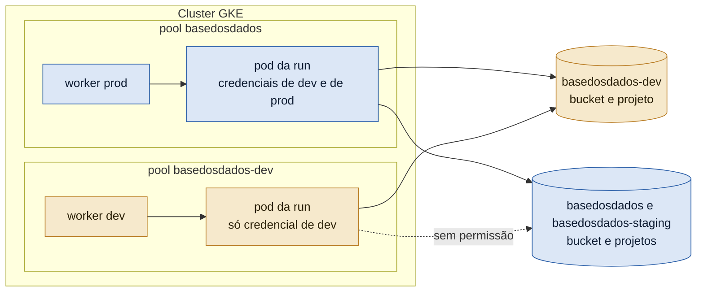
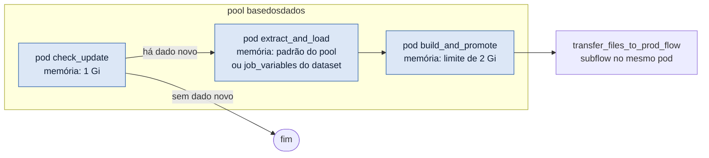
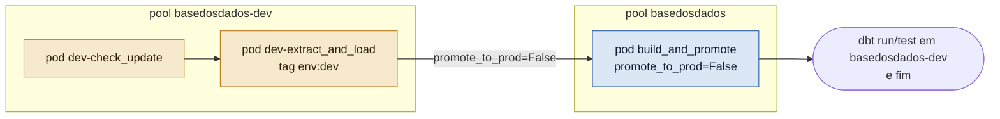

# Pools e pods de uma execução

## Contexto

O [fluxo de dados](../../../onboarding/fluxo-de-dados-e-infraestrutura.md) mostra por onde o
dado passa. Esta página mostra o que a infraestrutura cria para isso acontecer: em que pool cada
etapa roda, quantos pods sobem, com que recursos e com que credencial. É a visão para quem
precisa entender por que uma run ficou presa, por que um pod estourou memória ou por que um teste
em dev aparece no pool de prod.

Valores conferidos em 18/11/2026 na `main` do `pipelines` e na API do Prefect 3.

## A ideia central

### Dois pools, duas credenciais

O Prefect 3 roda no GKE com dois work pools do tipo Kubernetes. Cada pool tem um worker, e o
worker cria um pod novo para cada run. O que separa dev de prod é a credencial que o pod recebe:

Um pod do pool de dev não consegue escrever em prod, mesmo que o código tente. As service
accounts de cada pool estão em [Service accounts](../referencia/service-accounts.md).

### Cada flow vira dois deployments

O `deploy_flows.py` registra cada flow nos dois pools, com nomes e regras diferentes:

| | Deployment de prod | Deployment de dev |
|---|---|---|
| Nome | `<flow>` | `dev-<flow>` |
| Pool | `basedosdados` | `basedosdados-dev` |
| Schedule | O `deploy_schedules` do `flows.py`, ativado pela sincronização com o backend | Nenhum; a run é disparada à mão |
| Tag de ambiente | `env:prod` | `env:dev` |

A tag `env:dev` é o que o código lê, durante a run, para saber em que ambiente está.

### Os pods de uma execução em estágios

Uma execução de pipeline em estágios sobe até três pods, um depois do outro. Cada etapa dispara a
próxima com `run_deployment(timeout=0)` e termina sem esperar, então os pods não ficam vivos ao
mesmo tempo.

| Pod | Recursos | De onde vem |
|---|---|---|
| `check_update` | 1 Gi de memória (request e limite) | `CHECK_UPDATE_JOB_VARIABLES`, em `deploy_flows.py`, quando o flow não define os seus |
| `extract_and_load` | Padrão do pool: 500m a 2 CPU, 1 Gi a 4 Gi de memória | `job_variables` do flow, quando o dataset precisa de mais |
| `build_and_promote` | Limite de 2 Gi de memória | `BUILD_AND_PROMOTE_JOB_VARIABLES`, em `pipelines/utils/metadata/constants.py` |

O `build_and_promote` é um deployment só, compartilhado por todos os datasets. Uma mudança nele,
ou em `pipelines/utils/`, afeta todas as pipelines em estágios. Os limites do pool e como mudá-los
estão em [Recursos dos pods](../referencia/recursos-pods.md).

### Testar em dev também sobe um pod em prod

Quando você roda um dataset em dev, as duas primeiras etapas ficam no pool de dev, mas a cadeia
sempre chama o `build_and_promote` do pool de prod:

O `dev-extract_and_load` envia `promote_to_prod=False` porque tem a tag `env:dev`. O pod de prod
roda o dbt em `basedosdados-dev` e para. Na interface do Prefect, essa run aparece no pool de
prod, mas não toca em prod. A explicação de por que a decisão fica com o `extract_and_load` está
em [Pipeline orientado a eventos](../../../pipelines/explicacao/pipeline-orientado-a-eventos.md).

### Os outros desenhos

| Desenho | Pods de uma execução | Onde a promoção para prod roda |
|---|---|---|
| Flow único (dataset não migrado) | 1 pod, do começo ao fim | No mesmo pod |
| Estágios com tabelas derivadas (`br_ms_sim`) | 2 pods: `check_update` e `extract_and_load` | No pod do `extract_and_load` (`promote_primary_and_derived_tables`) |
| `table-approve` | Runner do GitHub Actions, fora do cluster, + 1 pod de `build_and_promote` por tabela | No pod do `build_and_promote`, no pool de prod |

## Trade-offs e alternativas consideradas

- **Pods separados por etapa:** cada etapa recebe só os recursos de que precisa, e uma falha na
  promoção pode ser repetida sem baixar o dado de novo. O custo é o tempo de subir um pod a cada
  etapa e mais runs para acompanhar na interface.
- **`build_and_promote` sempre no pool de prod:** só esse pool tem credencial para escrever em
  prod, e um deployment único evita ter 3 deployments por dataset. O efeito colateral é que um
  teste em dev ocupa o pool de prod e roda o dbt de dev com as credenciais do pool de prod.
- **Credencial como fronteira, e não o código:** mesmo que um dataset tente escrever em prod a
  partir do pool de dev, a service account não deixa.

## Ver também

- [Fluxo de dados e infraestrutura](../../../onboarding/fluxo-de-dados-e-infraestrutura.md) — por onde o dado passa
- [Pipeline orientado a eventos](../../../pipelines/explicacao/pipeline-orientado-a-eventos.md) — por que o flow foi dividido em etapas
- [Recursos dos pods](../referencia/recursos-pods.md) — limites de CPU e memória e como mudá-los
- [Service accounts](../referencia/service-accounts.md) — credenciais de cada pool
- [Workers](workers.md) — como os workers foram configurados
