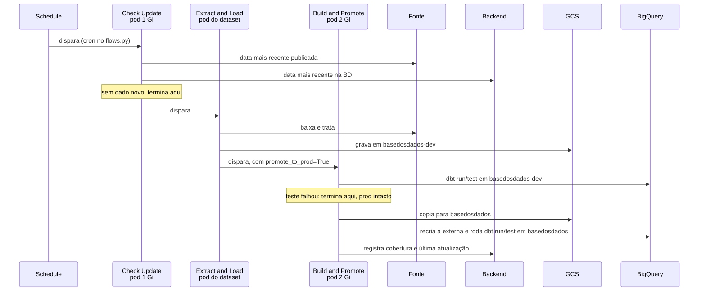
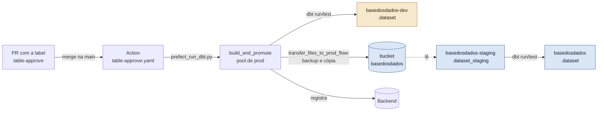

# Fluxo de dados e infraestrutura

Guia de onboarding sobre como o dado se move da fonte original até a publicação no projeto `basedosdados`, e sobre o que a infraestrutura faz em cada passo.

> Retrato da infraestrutura em novembro de 2026, já no Prefect 3. A [página de infraestrutura no site da BD](https://basedosdados.org/docs/colab_infrastructure#sistema-de-ingestão-de-dados) descreve a arquitetura antiga.

## Onde está o dado?

O dado passa por dois buckets e três projetos do BigQuery. Entre dev e prod há um portão: os testes dbt em dev.

### Componentes

| Componente | Tecnologia | Papel |
|---|---|---|
| Storage — dev | GCS, bucket **`basedosdados-dev`** | Recebe os arquivos tratados (parquet/csv) que alimentam as tabelas externas de dev. |
| Storage — prod | GCS, bucket **`basedosdados`** | Recebe os mesmos arquivos depois da validação em dev. A versão anterior vai para o bucket `basedosdados-backup`. |
| Data warehouse — dev | BigQuery, projeto **`basedosdados-dev`** | Guarda **as duas camadas**: `<dataset>_staging` (tabelas externas sobre o bucket `basedosdados-dev`) e `<dataset>` (modelos materializados pelo dbt). Usado pela equipe para validação. |
| Data warehouse — prod (staging) | BigQuery, projeto **`basedosdados-staging`** | Tabelas externas `<dataset>_staging` sobre o bucket `basedosdados`. **Não é exposto ao público.** |
| Data warehouse — prod (público) | BigQuery, projeto **`basedosdados`** | Modelos materializados pelo dbt a partir de `basedosdados-staging`. É o projeto consultado pelos usuários no site e no pacote Python. |
| Transformação e testes | [dbt](https://www.getdbt.com/) | Em dev (`target=dev`): lê `basedosdados-dev.<dataset>_staging` e materializa em `basedosdados-dev.<dataset>`. Em prod (`target=prod`): lê `basedosdados-staging.<dataset>_staging` e materializa em `basedosdados.<dataset>`. |
| Orquestrador | [Prefect 3](https://docs.prefect.io/v3/) — `prefect3.basedosdados.org` | Agenda e executa as [pipelines](../glossario.md#p). Os flows rodam em pods no Kubernetes, disparados pelos workers. Ver [Pools e pods de uma execução](../infraestrutura/prefect/explicacao/pools-e-pods.md). |
| Metadados | API GraphQL Django — `backend.basedosdados.org` (prod) / `staging.backend.basedosdados.org` (staging) | Fonte da verdade dos metadados expostos no site e no pacote Python. |
| Repositório de código | [`basedosdados/pipelines`](https://github.com/basedosdados/pipelines) | Hospeda os flows, os modelos dbt e as GitHub Actions. |
| CI/CD | GitHub Actions | `ci.yaml` (testes do PR e labels `test-dev-model` / `check-metadata`), `cd-prefect3.yaml` (deploy dos flows no Prefect 3) e `table-approve.yaml` (promoção para prod no merge). |

## O que todo caminho até prod tem em comum?

Qualquer que seja o caminho, o dado passa pelas mesmas quatro etapas, nesta ordem:

1. **Grava em dev.** Os arquivos tratados vão para o bucket `basedosdados-dev`, e a tabela externa `basedosdados-dev.<dataset>_staging` lê esses arquivos.
2. **Passa pelo portão.** O dbt materializa em `basedosdados-dev.<dataset>` e roda os testes. Se um teste falha, nada vai para prod.
3. **Promove para prod.** Os arquivos são copiados para o bucket `basedosdados`, a tabela externa em `basedosdados-staging` é recriada e o dbt materializa em `basedosdados.<dataset>`.
4. **Registra no backend.** A cobertura temporal (aberta e BD Pro), as row access policies, quando a tabela tem, e a data da última atualização são atualizadas a partir do que está no BigQuery.

Os caminhos diferem em quem dispara, onde cada etapa roda e se os testes rodam também em prod.

## Por quais caminhos o dado chega a prod?

| Caminho | Quem dispara | Onde a promoção roda | Testes em prod | Exemplo |
|---|---|---|---|---|
| Pipeline em estágios | Schedule do `check_update` | Pod do `build_and_promote`, pool de prod | `dbt run/test` | `br_bcb_agencia` |
| Pipeline em estágios com tabelas derivadas | Schedule do `check_update` | Pod do `extract_and_load` (`promote_primary_and_derived_tables`) | `dbt run/test` | `br_ms_sim` |
| Flow único (não migrado) | Schedule do flow | O único pod do flow | Depende do flow | `au_dcceew_greenhouse` |
| Pipeline semi-automatizada | Merge de PR com a label `table-approve` | Deployment `build_and_promote`, pool de prod | `dbt run/test` | PR semi-automatizado |

### Pipeline em estágios

Os datasets migrados dividem o trabalho em três etapas, cada uma num pod, disparadas pelo schedule declarado no `flows.py` (`deploy_schedules`, com `Cron`). Exemplo canônico: [`br_bcb_agencia`](https://github.com/basedosdados/pipelines/blob/main/pipelines/datasets/br_bcb_agencia/flows.py).

- Os três pods rodam no pool `basedosdados` (prod). Na interface do Prefect, as runs aparecem como `Check Update: <dataset>.<tabela>`, `Extract and Load: …` e `Build and Promote: …`.
- `check_update` só compara datas. Os pods de download e de dbt sobem apenas quando há dado novo.
- `build_and_promote` é um deployment genérico, compartilhado por todos os datasets migrados.
- Em tabela particionada, só as pastas novas são copiadas para `basedosdados`. Em tabela sem partição, a staging de prod vai antes para o bucket `basedosdados-backup`.

O porquê de cada etapa está em [Pipeline orientado a eventos](../pipelines/explicacao/pipeline-orientado-a-eventos.md). Para escrever um flow nesse formato, veja [Estruturar um flow de dataset](../pipelines/como-fazer/estruturar-um-flow-de-dataset.md).

### Flow único

Os datasets ainda não migrados fazem as quatro etapas num flow só, num único pod: baixam, sobem para `basedosdados-dev` (`upload_to_gcs`), rodam `run_dbt` em `target=dev`, sobem para `basedosdados`, rodam `run_dbt` em `target=prod` e chamam `register_table_materialization_task`. O pod tem o mesmo tamanho do começo ao fim, mesmo nas execuções em que não há dado novo.

### Pipeline semi-automatizada: promoção no merge

Numa [pipeline semi-automatizada](../glossario.md#p), quem faz as etapas 1 e 2 é a pessoa que escreve o código, e a promoção acontece no merge do PR. Do ponto de vista da infraestrutura:

1. A pessoa sobe os arquivos para `basedosdados-dev` e cria a tabela externa em `basedosdados-dev.<dataset>_staging`.
2. Roda os modelos e testes dbt em dev, localmente ou no CI, com a label `test-dev-model`.
3. Cadastra os metadados no backend, deixando a tabela `under_review`. A label `check-metadata` confere o cadastro no CI.
4. Quando a staging de dev está completa e final, a revisão aplica a label `table-approve`, e o PR é mergeado.

O passo a passo completo do colaborador está no [CONTRIBUTING.md do `pipelines`](https://github.com/basedosdados/pipelines/blob/main/CONTRIBUTING.md) e em [Abrir um PR](../pipelines/como-fazer/abrir-pr.md).

A label sozinha não dispara nada: a Action [`table-approve.yaml`](https://github.com/basedosdados/pipelines/blob/main/.github/workflows/table-approve.yaml) roda em todo push na `main` e, se o PR mergeado tiver a label, chama o script `prefect_run_dbt.py`. Para cada modelo `.sql` alterado no PR, o script dispara no Prefect 3 o deployment `build_and_promote`, o mesmo das pipelines em estágios. Ele testa a tabela em dev e só então promove:

Os detalhes e os riscos (troca da staging antes da materialização em prod, staging de dev vazia, esquema da tabela externa) estão em [Table-approve](../pipelines/explicacao/table-approve.md).

## Como testo sem afetar prod?

**Pipeline em estágios ou flow único.** Rode o deployment de dev (`dev-<flow>`), que fica no pool `basedosdados-dev` e não tem schedule. Os pods desse pool só têm credencial de dev e não conseguem escrever em prod. Na pipeline em estágios, a cadeia ainda passa pelo `build_and_promote` do pool de prod, mas com `promote_to_prod=False`:

Quem decide se promove é o `extract_and_load`, pelo pool em que ele rodou (`promote_to_prod = not _dev_prefix()`). O dataset não tem como configurar isso.

**Pipeline semi-automatizada.** Tudo até o merge fica em dev: os arquivos em `basedosdados-dev` e o dbt local ou no CI. Só o merge com a label `table-approve` leva para prod.

Os pools, pods e credenciais de cada caso estão em [Pools e pods de uma execução](../infraestrutura/prefect/explicacao/pools-e-pods.md).

## Quem atualiza os metadados?

> **Antes de preencher qualquer metadado, leia o [Manual de estilo](../governanca/metadados/explicacao-manual-de-estilo.md).** Ele é a referência canônica para nomes de datasets/tabelas/colunas, tipos no BigQuery, formatos de data, padronização de UF/município e estrutura de diretórios. Sem aderência ao manual, os metadados ficam inconsistentes com o que está materializado em `basedosdados`, e a tabela é barrada na revisão.

A API GraphQL Django é a fonte da verdade dos metadados que aparecem no site e no pacote `basedosdados`:

- **Produção** — `https://backend.basedosdados.org/api/v1/graphql`
- **Staging** — `https://staging.backend.basedosdados.org/api/v1/graphql`

| Quem | Quando | O que faz |
|---|---|---|
| Pessoa que escreve a pipeline | Antes do PR | Cadastra o conjunto, as tabelas e as colunas no admin do backend, com a tabela `under_review` |
| `check_update` | A cada execução agendada | Lê a data mais recente da tabela (cobertura ou última atualização) para decidir se há dado novo |
| `register_table_materialization_task` | Ao final de toda promoção para prod | Atualiza a cobertura temporal, as row access policies e a data da última atualização |

O código fica em `pipelines/utils/metadata/`. Para o passo a passo, veja [Subir metadados](../governanca/metadados/como-fazer/subir-metadados.md) (interface do Django) e [Registrar metadados no backend](../infraestrutura/prefect/como-fazer/registrar-metadados.md) (pelo Prefect).

## Como sei se atualizou, ou onde falhou?

| Run no Prefect | Pergunta que ela responde | Se falhou, o dado está em |
|---|---|---|
| `Check Update: <dataset>.<tabela>` | A fonte publicou algo mais novo do que a BD tem? | Nenhum lugar novo |
| `Extract and Load: <dataset>.<tabela>` | O download e o tratamento funcionaram? | Talvez parcial em `basedosdados-dev` |
| `Build and Promote: <dataset>.<tabela>` | O teste em dev passou? A cópia e o dbt em prod passaram? | Em dev; em prod, só se falhou depois da cópia |
| Run com o nome do flow (flow único, ex.: `au_dcceew_greenhouse`) | Em que etapa o flow parou? | Depende da etapa: veja o log |
| Action `table-approve` + run do `build_and_promote` | O teste em dev passou? A promoção do PR funcionou? | Em dev; em prod, staging já trocada se falhou depois da cópia |

Antes de concluir qualquer coisa, confira a fonte, o Prefect e o BigQuery, como descrito em [Diagnóstico com evidência](../processos/referencia/diagnostico-com-evidencia.md).

## Ver também

- [Setup do repositório de pipelines](setup-pipelines.md) — como preparar o ambiente antes de mexer em qualquer um destes fluxos.
- [Pipeline orientado a eventos](../pipelines/explicacao/pipeline-orientado-a-eventos.md) — por que o flow foi dividido em três etapas.
- [Table-approve](../pipelines/explicacao/table-approve.md) — como a promoção de dev para prod funciona no merge.
- [Pools e pods de uma execução](../infraestrutura/prefect/explicacao/pools-e-pods.md) — que pods cada etapa sobe, em que pool e com que credencial.
- [Arquitetura do Prefect 3](../infraestrutura/prefect/explicacao/arquitetura-prefect-3.md) — servidor, workers e pools.
- [Glossário](../glossario.md) — definições de **Pipeline**, **Pipeline semi-automatizada**, **BD Pro**.
