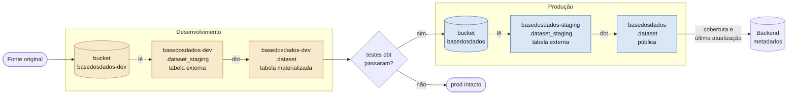
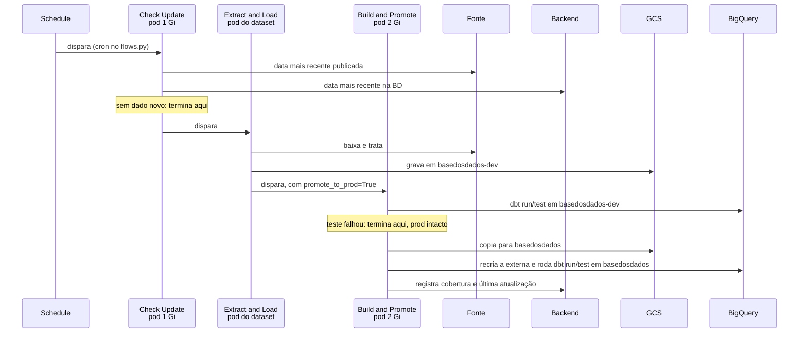
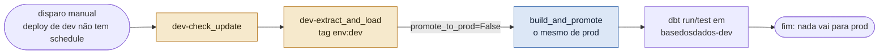
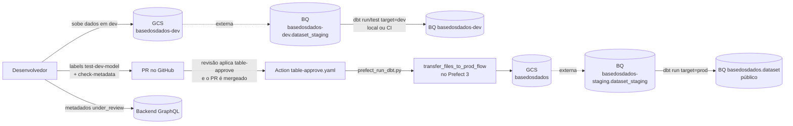

# Fluxo de dados e infraestrutura

Guia de onboarding com o retrato dos componentes de infraestrutura usados pela equipe dados e de como o dado se move entre eles, da fonte original até a publicação no projeto `basedosdados`.

> Retrato da infraestrutura em novembro de 2026, já no Prefect 3. A [página de infraestrutura no site da BD](https://basedosdados.org/docs/colab_infrastructure#sistema-de-ingestão-de-dados) descreve a arquitetura antiga.

## Componentes da infraestrutura

| Componente | Tecnologia | Papel |
|---|---|---|
| Orquestrador | [Prefect 3](https://docs.prefect.io/v3/) — `prefect3.basedosdados.org` | Agenda e executa as [pipelines](../glossario.md#p). Os flows rodam em pods no Kubernetes, disparados pelos workers. Ver [Arquitetura do Prefect 3](../infraestrutura/prefect/explicacao/arquitetura-prefect-3.md). |
| Repositório de código | [`basedosdados/pipelines`](https://github.com/basedosdados/pipelines) | Hospeda os flows, os modelos dbt e as GitHub Actions de CI, deploy e `table-approve`. |
| Storage — dev | GCS, bucket **`basedosdados-dev`** | Recebe os arquivos tratados (parquet/csv) que alimentam as tabelas externas de dev. |
| Storage — prod | GCS, bucket **`basedosdados`** | Recebe os mesmos arquivos depois da validação em dev. A versão anterior vai para o bucket `basedosdados-backup`. |
| Data warehouse — dev | BigQuery, projeto **`basedosdados-dev`** | Guarda **as duas camadas**: `<dataset>_staging` (tabelas externas sobre o bucket `basedosdados-dev`) e `<dataset>` (modelos materializados pelo dbt). Usado pela equipe para validação. |
| Data warehouse — prod (staging) | BigQuery, projeto **`basedosdados-staging`** | Tabelas externas `<dataset>_staging` sobre o bucket `basedosdados`. **Não é exposto ao público.** |
| Data warehouse — prod (público) | BigQuery, projeto **`basedosdados`** | Modelos materializados pelo dbt a partir de `basedosdados-staging`. É o projeto consultado pelos usuários no site e no pacote Python. |
| Transformação e testes | [dbt](https://www.getdbt.com/) | Em dev (`target=dev`): lê `basedosdados-dev.<dataset>_staging` e materializa em `basedosdados-dev.<dataset>`. Em prod (`target=prod`): lê `basedosdados-staging.<dataset>_staging` e materializa em `basedosdados.<dataset>`. |
| Metadados | API GraphQL Django — `backend.basedosdados.org` (prod) / `staging.backend.basedosdados.org` (staging) | Fonte da verdade dos metadados expostos no site e no pacote Python. |
| CI/CD | GitHub Actions | `ci.yaml` (testes do PR e labels `test-dev-model` / `check-metadata`), `cd-prefect3.yaml` (deploy dos flows no Prefect 3) e `table-approve.yaml` (promoção para prod no merge). |

## Visão geral: onde o dado mora

O dado passa por dois buckets e três projetos do BigQuery. Entre dev e prod há um portão: os testes dbt em dev.

A diferença entre [pipeline automatizada](../glossario.md#p) e [semi-automatizada](../glossario.md#p) está em **como** o portão é cruzado e **quem** dispara a promoção para prod.

## 1. Pipelines automatizadas (Prefect 3)

A pipeline roda no schedule declarado no próprio `flows.py` do dataset (`deploy_schedules`, com `Cron`). Hoje convivem dois desenhos de flow.

### Pipeline em estágios: uma execução em prod

Os datasets migrados dividem o trabalho em três etapas, cada uma num pod. Exemplo canônico: [`br_bcb_agencia`](https://github.com/basedosdados/pipelines/blob/main/pipelines/datasets/br_bcb_agencia/flows.py).

**Pontos importantes:**

- Os três pods rodam no pool `basedosdados` (prod). Na interface do Prefect, as runs aparecem como `Check Update: <dataset>.<tabela>`, `Extract and Load: …` e `Build and Promote: …`.
- `check_update` só compara datas. Os pods de download e de dbt sobem apenas quando há dado novo.
- `build_and_promote` é um deployment genérico, compartilhado por todos os datasets migrados.
- Em tabela particionada, só as pastas novas são copiadas para `basedosdados`. Em tabela sem partição, a staging de prod vai antes para o bucket `basedosdados-backup`.
- Ao final, `register_table_materialization_task` lê o BigQuery e atualiza no backend a cobertura temporal (aberta e BD Pro), as row access policies, quando a tabela tem, e a data da última atualização.

O desenho completo, com o porquê de cada etapa, está em [Pipeline orientado a eventos](../pipelines/explicacao/pipeline-orientado-a-eventos.md). Os pods, pools e credenciais de cada etapa estão em [Pools e pods de uma execução](../infraestrutura/prefect/explicacao/pools-e-pods.md). Para escrever um flow nesse formato, veja [Estruturar um flow de dataset](../pipelines/como-fazer/estruturar-um-flow-de-dataset.md).

### Pipeline em estágios: o que muda quando você testa em dev

Quem decide se promove é o `extract_and_load`, pelo pool em que ele rodou (`promote_to_prod = not _dev_prefix()`). O dataset não tem como configurar isso, então um teste em dev nunca chega a prod.

### Flow único (datasets ainda não migrados)

Os datasets ainda não migrados fazem tudo num flow só, num único pod: baixam, sobem para `basedosdados-dev` (`upload_to_gcs`), rodam `run_dbt` em `target=dev`, sobem para `basedosdados`, rodam `run_dbt` em `target=prod` e chamam `register_table_materialization_task`. Os passos e o portão são os mesmos, mas o pod tem o mesmo tamanho do começo ao fim, mesmo nas execuções em que não há dado novo.

## 2. Códigos semi-automatizados

[Pipelines semi-automatizadas](../glossario.md#p) são modelos dbt + script de carga executados manualmente pelo dev, com a materialização em produção disparada pelo merge de um PR com a label `table-approve`.

### Passo a passo do colaborador

1. Baixar a pasta template e os dados originais.
2. Preencher as **tabelas de arquitetura** e marcar a equipe de dados na issue ao finalizar.
3. Escrever pipeline de carregamento dos dados (script Python que sobe arquivos para `basedosdados-dev`).
4. Subir as tabelas em `basedosdados-dev.<dataset>_staging` no BigQuery (tabela externa sobre o GCS).
5. Escrever modelos **dbt** para transformação em `models/<dataset>/`.
6. Escrever testes **dbt**.
7. Organizar arquivos auxiliares, se necessário.
8. Criar tabela `dicionario`, se necessário.
9. Preencher os metadados na API do backend, deixando a tabela como `under_review`.
10. Abrir o PR.
11. Aplicar as labels **`test-dev-model`** e **`check-metadata`** no PR.
12. Enviar para revisão.

### Deploy via `table-approve`

Quando a staging de dev está completa e final, a revisão aplica a label **`table-approve`**. A label sozinha não dispara nada: a Action [`table-approve.yaml`](https://github.com/basedosdados/pipelines/blob/main/.github/workflows/table-approve.yaml) roda em todo push na `main` e, se o PR mergeado tiver a label, chama o script `prefect_run_dbt.py`. Para cada modelo `.sql` alterado no PR, o script dispara no Prefect 3 o flow `transfer_files_to_prod_flow`, que:

1. Faz backup da staging de prod no bucket `basedosdados-backup` e copia os arquivos de `basedosdados-dev` para `basedosdados`.
2. Recria a tabela externa em `basedosdados-staging.<dataset>_staging`.
3. Roda `dbt run` com `target=prod` e exporta o CSV de download.
4. Registra a materialização no backend (cobertura e atualização).

A diferença prática com a pipeline automatizada: a promoção é disparada pela **Action**, no merge, e não pelo schedule; e o gatilho é humano (a label). O flow que faz a cópia e a materialização é o mesmo que o `build_and_promote` usa. Os detalhes e os riscos (troca da staging antes da materialização, esquema da tabela externa) estão em [Table-approve](../pipelines/explicacao/table-approve.md).

## Todos os caminhos até prod

| Caminho | Quem dispara | Onde a promoção roda | Testes em prod | Exemplo |
|---|---|---|---|---|
| Pipeline em estágios | Schedule do `check_update` | Pod do `build_and_promote`, pool de prod | `dbt run/test` | `br_bcb_agencia` |
| Estágios com tabelas derivadas | Schedule do `check_update` | Pod do `extract_and_load` (`promote_primary_and_derived_tables`) | `dbt run/test` | `br_ms_sim` |
| Flow único (não migrado) | Schedule do flow | O único pod do flow | Depende do flow | `au_dcceew_greenhouse` |
| `table-approve` | Merge de PR com a label | Deployment `transfer_files_to_prod_flow`, pool de prod | Só `dbt run`; o teste roda no CI, em dev ([#2325](https://github.com/basedosdados/pipelines/issues/2325)) | PR semi-automatizado |

Os quatro caminhos registram a materialização no backend ao final.

## Onde olhar quando algo falha

| Run no Prefect | Pergunta que ela responde | Se falhou, o dado está em |
|---|---|---|
| `Check Update: <dataset>.<tabela>` | A fonte publicou algo mais novo do que a BD tem? | Nenhum lugar novo |
| `Extract and Load: <dataset>.<tabela>` | O download e o tratamento funcionaram? | Talvez parcial em `basedosdados-dev` |
| `Build and Promote: <dataset>.<tabela>` | O teste em dev passou? A cópia e o dbt em prod passaram? | Em dev; em prod, só se falhou depois da cópia |
| Action `table-approve` + run do `transfer_files_to_prod_flow` | A promoção do PR funcionou? | Staging de prod já trocada, se falhou no dbt |

Antes de concluir qualquer coisa, confira a fonte, o Prefect e o BigQuery, como descrito em [Diagnóstico com evidência](../processos/referencia/diagnostico-com-evidencia.md).

## 3. Preenchimento de metadados na API do backend

> **Antes de preencher qualquer metadado, leia o [Manual de estilo](../governanca/metadados/explicacao-manual-de-estilo.md).** Ele é a referência canônica para nomes de datasets/tabelas/colunas, tipos no BigQuery, formatos de data, padronização de UF/município e estrutura de diretórios. Sem aderência ao manual, os metadados ficam inconsistentes com o que está materializado em `basedosdados`, e a tabela é barrada na revisão.

A API GraphQL Django é a fonte da verdade dos metadados que aparecem no site e no pacote `basedosdados`. Endpoints:

- **Produção** — `https://backend.basedosdados.org/api/v1/graphql`
- **Staging** — `https://staging.backend.basedosdados.org/api/v1/graphql`

Pontos de contato a partir do repositório `pipelines` (código em `pipelines/utils/metadata/`):

- **`check_update`** (pipeline em estágios): lê do backend a data mais recente da tabela (cobertura ou última atualização) para decidir se há dado novo.
- **`register_table_materialization_task`**: ao final da materialização em prod, pelo flow ou pelo `table-approve`, atualiza a cobertura temporal, as row access policies e a data da última atualização.
- **Fluxo semi-automatizado**: o colaborador cadastra a tabela no admin do backend, deixando-a `under_review` antes do PR.

Para o passo a passo, veja [Subir metadados](../governanca/metadados/como-fazer/subir-metadados.md) (interface do Django) e [Registrar metadados no backend](../infraestrutura/prefect/como-fazer/registrar-metadados.md) (pelo Prefect).

## Ver também

- [Setup do repositório de pipelines](setup-pipelines.md) — como preparar o ambiente antes de mexer em qualquer um destes fluxos.
- [Pipeline orientado a eventos](../pipelines/explicacao/pipeline-orientado-a-eventos.md) — por que o flow foi dividido em três etapas.
- [Table-approve](../pipelines/explicacao/table-approve.md) — como a promoção de dev para prod funciona no merge.
- [Arquitetura do Prefect 3](../infraestrutura/prefect/explicacao/arquitetura-prefect-3.md) — servidor, workers e pools.
- [Pools e pods de uma execução](../infraestrutura/prefect/explicacao/pools-e-pods.md) — que pods cada etapa sobe, em que pool e com que credencial.
- [Glossário](../glossario.md) — definições de **Pipeline**, **Pipeline semi-automatizada**, **BD Pro**.
- [`basedosdados/pipelines` — CONTRIBUTING.md](https://github.com/basedosdados/pipelines/blob/main/CONTRIBUTING.md) — referência operacional para o passo a passo do colaborador semi-automatizado.
