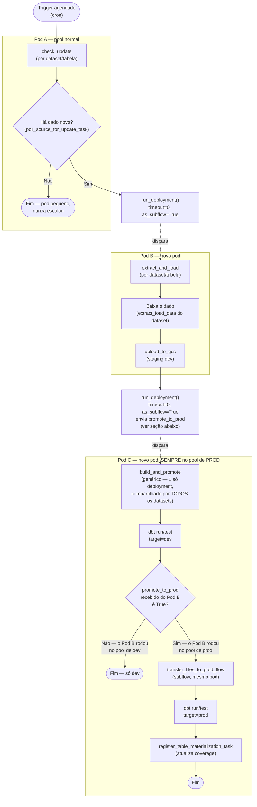
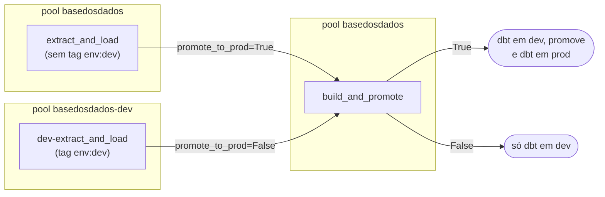

# Pipeline orientado a eventos

Este documento esclarece o contexto em que se estruturou a nova configuração dos _flows_, qual a nova estrutura, quais são seus componentes e o que fazem. 

## Contexto

Antes desta arquitetura, um flow de dataset era monolítico, seguindo, em uma única execução, o seguinte conjunto de passos:
1. Checar se havia dado novo:
2. Baixar;
3. Subir pro GCS (`pipelines/utils/tasks.py:upload_to_gcs`);
4. Materializar em dev; 
5. Testar;
6. Promover pra prod (caso teste fosse bem sucedido);
7. Atualizar metadados. 

Tudo em uma única execução, um único pod Kubernetes. Isso gerava quatro
problemas, registrados na proposta original:

([issue #1867](https://github.com/basedosdados/pipelines/issues/1867)):

1. **Desperdício de recurso** — pods de 4 GB subiam só pra verificar se havia dado
   novo. Na maioria das execuções a resposta é "não", sem justificar o custo.
2. **Recursos idênticos pra cargas diferentes** — check (leve), download (médio) e
   materialização dbt (pesada) rodavam no mesmo pod, com a mesma alocação.
3. **Cota de BigQuery compartilhada** — o gate de dev consumia a cota de
   `basedosdados-dev` junto com o desenvolvimento manual da equipe.
4. **Reruns custosos** — uma falha em prod obrigava rerrodar tudo desde o check,
   mesmo que o dado já estivesse no storage.

## A ideia central

Um dataset migrado vira **2 ou 3 flows encadeados**, cada um no seu próprio pod, em
vez de um flow monolítico fazendo tudo numa execução só:



Três etapas (`Etapa`, em `stage_dispatch.py`): `check_update`, `extract_and_load`,
`build_and_promote`. Cada uma é um deployment Prefect independente, num pod próprio
— o isolamento de recurso que resolve os problemas 1 e 2 do contexto.

### Como uma etapa dispara a próxima

Cada etapa chama `run_deployment()` **direto no próprio código** ao terminar com
sucesso — `timeout=0` (não espera o próximo terminar) e `as_subflow=True` (o run
disparado aparece linkado como filho na árvore de execução do Prefect UI, lineage
de verdade). Não existe automação externa nem evento — a lógica de "quem dispara
quem" mora no código Python de cada dataset, que já sabe seu próprio `dataset_id`.

### `build_and_promote` é genérico

Diferente de `check_update`/`extract_and_load` (um flow por dataset/tabela),
`build_and_promote` é **um único deployment, compartilhado por todos os
datasets** (`pipelines/utils/metadata/flows.py`). Ele roda `dbt run/test` em dev,
decide se promove pra prod, roda `dbt run/test` em prod se promover, e atualiza a
coverage no backend. Isso mantém o número de deployments crescendo de forma linear
com o número de datasets (N `check_update` + N `extract_and_load` + 1
`build_and_promote`), em vez de 3×N.

### dev/prod é derivado, não configurado

Cada flow de dataset tem dois deployments: um no pool `basedosdados` (prod) e um no
pool `basedosdados-dev`, com o prefixo `dev-` no nome. Só o deployment de dev recebe
a tag `env:dev`, que `deploy_flows.py` adiciona no deploy.

O `build_and_promote` é a exceção: existe um deployment só, sempre no pool de prod,
porque só a service account desse pool pode escrever em prod. Ele não sabe, pelo
próprio pool, se a execução começou em dev ou em prod. Por isso quem decide é a
etapa anterior:



Ao terminar, o `extract_and_load` chama `dispatch_build_and_promote`, que monta os
parâmetros do `build_and_promote` com:

```python
"promote_to_prod": not _dev_prefix(),
```

`_dev_prefix()` procura a tag `env:dev` na execução atual. Se a tag está lá,
`promote_to_prod` é `False`; se não está, é `True`.

O ponto central de segurança: `promote_to_prod` **não é um campo que o dataset
preenche**. Nem o `flows.py` nem o `ExtractAndLoad` devolvido pelo dataset têm esse
campo. Um teste em dev nunca promove para prod, por garantia estrutural, e não por
uma configuração que o código do dataset possa definir errado.

### Duas variantes

| Variante | Flows | Pra quais fontes |
|---|---|---|
| **Padrão** | `check_update` → `extract_and_load` → `build_and_promote` | Fonte expõe a data mais recente sem baixar o dado inteiro (HEAD, API de metadata, listagem FTP) |
| **`check_and_download`** | `check_and_download` → `build_and_promote` | Só dá pra saber se há dado novo baixando o arquivo |

Só a variante **padrão** tem código real hoje (`CheckThenExtractLoadPipeline`/
`pipeline_factory`, em `stage_dispatch.py`); `check_and_download` segue como
proposta, sem implementação.

### O que o autor de um dataset escreve, e o que já existe pronto

`CheckThenExtractLoadPipeline` (direto, ou via `pipeline_factory` pra datasets
multi-tabela) encapsula todo o boilerplate repetido entre as etapas — rename do
flow run, poll/commit de coverage, dispatch pro próximo estágio. Quem migra um
dataset só fornece duas funções Python puras: `get_latest_update` (descobre a data
mais recente na fonte) e `extract_load_data` (baixa o dado de verdade). Ver
[como estruturar um flow de dataset](../como-fazer/estruturar-um-flow-de-dataset.md).

## Trade-offs e alternativas consideradas

A decisão, as alternativas descartadas e as consequências estão registradas no
[ADR-0001 — Dividir os flows de dataset em estágios encadeados](../adr/0001-dividir-flows-em-estagios.md).
Em resumo:

- **`run_deployment()` no código, em vez de Automação do Prefect:** mantém o encadeamento no código
  de cada dataset e o run disparado linkado como subflow, ao custo de não ter uma visão agregada de
  "o que dispara o quê".
- **Um pod por estágio:** cada estágio recebe só os recursos de que precisa, ao custo de 70 a 90
  segundos a mais para subir cada pod.
- **dev e prod no mesmo pod do `build_and_promote`:** evita um pod a mais por execução; o
  isolamento de cota vem do `execution_project` do target dbt.
- **Promoção derivada do pool, e não declarada pelo dataset:** um teste em dev não consegue
  promover para prod.
- **Duas variantes:** o check leve não é possível em toda fonte, e baixar sempre desperdiçaria
  recurso nas que permitem.

## Ver também

- [Como estruturar um flow de dataset](../como-fazer/estruturar-um-flow-de-dataset.md)
- [Referência — `stage_dispatch.py`](../referencia/stage-dispatch.md)
- [ADR-0001 — Dividir os flows de dataset em estágios encadeados](../adr/0001-dividir-flows-em-estagios.md) — a decisão e as alternativas
- [issue #1867 — Dividir flows monolíticos em estágios](https://github.com/basedosdados/pipelines/issues/1867) (histórico completo da decisão e lista nominal de datasets por categoria de check)
- [PR #1932 — migração real, testes e revisão](https://github.com/basedosdados/pipelines/pull/1932)
