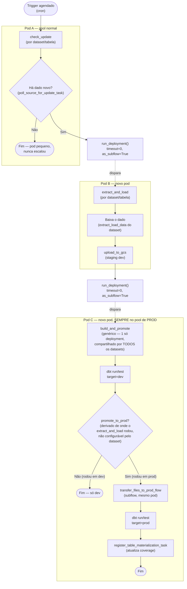

# Pipeline orientado a eventos

Este documento esclarece o contexto em que se estruturou a nova configuração dos _flows_, qual a nova estrutura, quais são seus componentes e o que fazem. 

## Contexto

Antes desta arquitetura, um flow de dataset era monolítico, seguindo, em uma única execução, o seguinte conjunto de passos:
1. Checar se havia dado novo:
2. Baixar;
3. Subir pro GCS (`pipelines/utils/tasks.py:upload_to_gcs`);
4. Materializar em dev; 
5. Testar;
6. Promover pra prod (caso teste fosse bem sucedido);
7. Atualizar metadados. 

Tudo em uma única execução, um único pod Kubernetes. Isso gerava quatro
problemas, registrados na proposta original:

([issue #1867](https://github.com/basedosdados/pipelines/issues/1867)):

1. **Desperdício de recurso** — pods de 4 GB subiam só pra verificar se havia dado
   novo. Na maioria das execuções a resposta é "não", sem justificar o custo.
2. **Recursos idênticos pra cargas diferentes** — check (leve), download (médio) e
   materialização dbt (pesada) rodavam no mesmo pod, com a mesma alocação.
3. **Cota de BigQuery compartilhada** — o gate de dev consumia a cota de
   `basedosdados-dev` junto com o desenvolvimento manual da equipe.
4. **Reruns custosos** — uma falha em prod obrigava rerrodar tudo desde o check,
   mesmo que o dado já estivesse no storage.

## A ideia central

Um dataset migrado vira **2 ou 3 flows encadeados**, cada um no seu próprio pod, em
vez de um flow monolítico fazendo tudo numa execução só:

Três etapas (`Etapa`, em `stage_dispatch.py`): `check_update`, `extract_and_load`,
`build_and_promote`. Cada uma é um deployment Prefect independente, num pod próprio
— o isolamento de recurso que resolve os problemas 1 e 2 do contexto.

### Como uma etapa dispara a próxima

Cada etapa chama `run_deployment()` **direto no próprio código** ao terminar com
sucesso — `timeout=0` (não espera o próximo terminar) e `as_subflow=True` (o run
disparado aparece linkado como filho na árvore de execução do Prefect UI, lineage
de verdade). Não existe automação externa nem evento — a lógica de "quem dispara
quem" mora no código Python de cada dataset, que já sabe seu próprio `dataset_id`.

### `build_and_promote` é genérico

Diferente de `check_update`/`extract_and_load` (um flow por dataset/tabela),
`build_and_promote` é **um único deployment, compartilhado por todos os
datasets** (`pipelines/utils/metadata/flows.py`). Ele roda `dbt run/test` em dev,
decide se promove pra prod, roda `dbt run/test` em prod se promover, e atualiza a
coverage no backend. Isso mantém o número de deployments crescendo de forma linear
com o número de datasets (N `check_update` + N `extract_and_load` + 1
`build_and_promote`), em vez de 3×N.

### dev/prod é derivado, não configurado

`deploy_flows.py` marca cada deployment com uma tag `env:dev`/`env:prod` conforme o
pool de destino. Em runtime, `_dev_prefix()` lê essa tag pra resolver o prefixo
`dev-` do próximo deployment a disparar. O ponto central de segurança:
`promote_to_prod` (passado pro `build_and_promote`) **não é um campo que o dataset
preenche** — é derivado de `_dev_prefix()`, ou seja, de onde o `extract_and_load`
realmente rodou. Um teste em dev nunca promove pra prod de verdade, por garantia
estrutural, não por configuração que o código do dataset possa (mal) definir.

### Duas variantes

| Variante | Flows | Pra quais fontes |
|---|---|---|
| **Padrão** | `check_update` → `extract_and_load` → `build_and_promote` | Fonte expõe a data mais recente sem baixar o dado inteiro (HEAD, API de metadata, listagem FTP) |
| **`check_and_download`** | `check_and_download` → `build_and_promote` | Só dá pra saber se há dado novo baixando o arquivo |

Só a variante **padrão** tem código real hoje (`CheckThenExtractLoadPipeline`/
`pipeline_factory`, em `stage_dispatch.py`); `check_and_download` segue como
proposta, sem implementação.

### O que o autor de um dataset escreve, e o que já existe pronto

`CheckThenExtractLoadPipeline` (direto, ou via `pipeline_factory` pra datasets
multi-tabela) encapsula todo o boilerplate repetido entre as etapas — rename do
flow run, poll/commit de coverage, dispatch pro próximo estágio. Quem migra um
dataset só fornece duas funções Python puras: `get_latest_update` (descobre a data
mais recente na fonte) e `extract_load_data` (baixa o dado de verdade). Ver
[como estruturar um flow de dataset](../como-fazer/estruturar-um-flow-de-dataset.md).

## Trade-offs e alternativas consideradas

**`run_deployment()` direto no código, em vez de Automação do Prefect 3 +
`emit_event()`.** A proposta original encadeava as etapas por Automação —
prototipado, testado de ponta a ponta com sucesso, e abandonado antes do rollout
real. Motivos:

- Escalar automações pra ~82 datasets exigiria um mecanismo próprio de descoberta
  e sincronização em massa (objetos `Automation` mantidos à parte do código) — uma
  peça de infraestrutura inteira só pra resolver um problema que `run_deployment()`
  não tem, já que a lógica de disparo já mora no código de cada dataset.
- Parâmetros de automação são sempre renderizados via Jinja como string — nunca
  preservam tipo nativo, exigindo um workaround de serialização JSON manual.
  `run_deployment(parameters={...})` passa um dict nativo, validado
  automaticamente pelo schema tipado do flow.
- `as_subflow=True` linka o run disparado como filho de verdade na árvore de
  execução do Prefect UI; um run disparado por Automação aparece solto,
  correlacionado só por tag/tempo.
- Em troca, perde-se a visão agregada "o que dispara o quê" sem ler código (as
  automações tinham uma aba própria no Prefect UI), o desacoplamento de falha
  (hoje, uma falha ao disparar o próximo estágio vira exceção **dentro** do flow
  upstream, podendo marcá-lo como `Failed` mesmo que o trabalho dele já tivesse
  sido concluído) e a possibilidade de qualquer evento externo disparar uma etapa.
  Nenhuma dessas capacidades era usada por algo real no desenho — julgado uma
  troca razoável para evitar construir infraestrutura de automação em massa que
  ainda não existia.

**3 pods separados, apesar do overhead de agendamento por hop (~70-90s
medidos).** Irrelevante contra um trigger agendado (cron) — o problema que a
arquitetura resolve (desperdício de recurso, cota compartilhada) pesa mais que o
tempo de subir um pod extra.

**dev e prod no mesmo pod dentro de `build_and_promote`**, em vez de dois flows
separados (`dev_build`/`prod_build`). Dois flows permitiriam rerrodar só prod se
prod falhasse — caso raro na prática — mas o custo de um pod extra por execução
não se justifica. O isolamento de cota BQ entre dev e prod vem do
`execution_project` do target dbt, não de pods separados.

**`ExtractAndLoad.targets` removido.** A primeira versão deixava o dataset
declarar, em código, se o resultado deveria promover pra prod (`targets: list[str]
= ["dev", "prod"]`). Isso era um risco real — o dataset podia "dizer" pra promover
mesmo rodando num teste em dev. Substituído pela derivação estrutural via
`_dev_prefix()` (ver "A ideia central" acima).

**Duas variantes, não uma só.** Forçar todo dataset na variante padrão seria
impossível para fontes que não expõem a data mais recente sem baixar o arquivo
inteiro (uma fração relevante dos datasets do repo); forçar todos a sempre baixar
pra checar desperdiçaria a economia de recurso que motivou a arquitetura para as
fontes que já expõem a data de forma leve.

## Ver também

- [Como estruturar um flow de dataset](../como-fazer/estruturar-um-flow-de-dataset.md)
- [Referência — `stage_dispatch.py`](../referencia/stage-dispatch.md)
- [issue #1867 — Dividir flows monolíticos em estágios](https://github.com/basedosdados/pipelines/issues/1867) (histórico completo da decisão e lista nominal de datasets por categoria de check)
- [PR #1932 — migração real, testes e revisão](https://github.com/basedosdados/pipelines/pull/1932)
