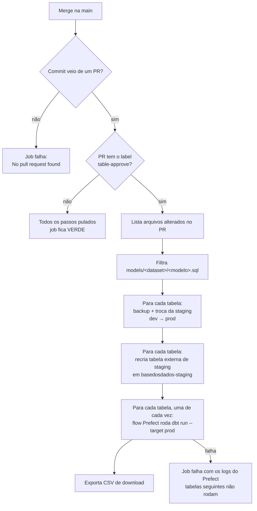

# Table-approve

## Contexto

Os dados de uma tabela são preparados e validados na zona de dev
(`basedosdados-dev`). A zona de prod (`basedosdados` e `basedosdados-staging`)
não é alterada manualmente: as credenciais de prod existem apenas no GitHub
Actions e nos workers do Prefect.

O `table-approve` é o mecanismo que leva para prod as tabelas alteradas em um
PR do repositório [`pipelines`](https://github.com/basedosdados/pipelines). Ele é
executado no merge para a `main`, desde que o PR possua o label
`table-approve`, e substitui a staging de prod pela de dev antes de
materializar cada tabela com o dbt.

## A ideia central

### Momento de uso no desenvolvimento

O label é a última etapa antes do merge. Seu efeito ocorre apenas no merge,
mas ele copia para prod a staging de dev **no estado em que ela estiver
naquele momento**. Por isso, deve ser aplicado somente quando nada mais vai
mudar em dev.

| Fase do PR | Atividade | Label |
|---|---|---|
| Desenvolvimento | Carga da staging em dev, escrita dos modelos dbt, `dbt run` e `dbt test` em dev | Não aplicar |
| PR aberto | `test-dev-model`, `check-metadata` e, em PRs de pipeline, `deploy-flow` | Não aplicar |
| Revisão | Ajustes de código, dados ou modelos solicitados na revisão | Não aplicar |
| Pronto para merge | PR aprovado, staging de dev final e completa, metadados registrados no backend de prod | **Aplicar** |
| Merge | Execução do table-approve | Aplicado |
| Após o merge | Verificação das tabelas em prod e publicação do dataset | — |

O label é necessário apenas quando o PR altera algum arquivo
`models/<dataset>/<modelo>.sql` e a tabela correspondente deve ser
reconstruída em prod a partir da staging de dev. PRs que alteram somente
metadados, `schema.yml`, código de pipeline ou documentação não são afetados
pelo processo.

### Funcionamento



O workflow está em `.github/workflows/table-approve.yaml`, e as etapas 2 a 5
estão no script `.github/workflows/scripts/prefect_run_dbt.py`. Os trechos
abaixo foram reduzidos para destacar o comportamento de cada etapa.

#### 1. Gatilho

O workflow é executado em todo push na `main`. Em seguida, ele identifica o PR
que originou o commit e verifica se o label está presente. O label, portanto,
não dispara o processo: ele é lido no momento da execução. Sem o label, as
etapas seguintes são ignoradas e o job termina com sucesso.

```yaml
on:
  push:
    branches: [main]   # executa em todo merge na main
```

```javascript
// verifica se o PR do commit possui o label
const approved = labels.data.some(label => label.name === "table-approve");
```

#### 2. Seleção das tabelas

A função `get_datasets_tables_from_modified_files` considera apenas os arquivos
`.sql` com exatamente três níveis de caminho, ou seja,
`models/<dataset>/<modelo>.sql`. Arquivos em subdiretórios, em `tests-dbt/` ou
em `macros/` ficam de fora. O dataset é o nome do diretório, e a tabela é o
nome do arquivo sem o prefixo `<dataset>__`.

```python
# mantém só models/<dataset>/<modelo>.sql
sql_files = [
    file
    for file in modified_files
    if file.suffix == ".sql"
    and len(file.parts) == 3
    and file.parts[0] == "models"
]

# remove o prefixo <dataset>__ para obter o nome da tabela
crop_str = f"{dataset_id}__"
if table_id.startswith(crop_str):
    table_id = table_id[len(crop_str) :]
    alias = True
```

#### 3. Substituição da staging

A função `sync_bucket` copia a staging de prod para o bucket de backup, apaga a
staging de prod e copia a staging de dev no lugar. Se a staging de dev estiver
vazia, a função retorna antes de qualquer cópia, o log registra
`TABLE was NOT created` e o processo continua com a staging de prod existente.

```python
# staging de dev vazia: nada é copiado
if len(list(source_ref)) == 0:
    return True

# staging de prod existente: guarda no backup e apaga
if len(list(destination_ref)):
    ref.copy_table(source_bucket_name=destination_bucket_name,
                   destination_bucket_name=backup_bucket_name, mode=mode)
    ref.delete_table(not_found_ok=True, mode=mode,
                     bucket_name=destination_bucket_name)

# copia a staging de dev para prod
ref.copy_table(source_bucket_name=source_bucket_name,
               destination_bucket_name=destination_bucket_name, mode=mode)
```

#### 4. Recriação da tabela externa

A função `save_header_files` percorre os arquivos da staging de dev e para no
**primeiro** `.csv` ou `.parquet` encontrado. Em CSV, as colunas vêm de uma
consulta à tabela externa de dev; em Parquet, do próprio arquivo. Com esse
cabeçalho, `push_table_to_bq` recria a tabela
`basedosdados-staging.<dataset>_staging.<tabela>`, com todas as colunas como
STRING.

```python
# para no primeiro arquivo de dados da staging de dev
for blob in blobs:
    if blob_name.endswith((".csv", ".parquet")):
        break

# CSV: colunas lidas da tabela externa de dev
query = f"SELECT * FROM `basedosdados-dev.{dataset_id}_staging.{table_id}` LIMIT 1"

# Parquet: o próprio arquivo é usado como cabeçalho
blob.download_to_filename(file_path)
```

#### 5. Materialização

Para cada tabela, uma de cada vez, o script dispara o flow do Prefect
`run_dbt_model_flow`, que executa `dbt run --target prod` e exporta o CSV de
download. Se um flow falhar, o script exibe os logs de erro do Prefect e
encerra o job, e as tabelas seguintes não são processadas.

```python
flow_run = run_deployment(
    name=DBT_MODEL_DEPLOYMENT,
    parameters={
        "dataset_id": dataset_id,
        "table_id": table_id,
        "dbt_command": args.dbt_command,     # "run"
        "dbt_alias": alias,
        "target": args.materialization_target,   # "prod"
        "download_csv_file": args.materialization_target == "prod",
    },
)

# falha em uma tabela encerra o job
if state is None or not state.is_completed():
    print_flow_run_error_logs(str(flow_run.id))
    raise Exception(...)
```

As etapas 3 e 4 são executadas para todas as tabelas antes da primeira
materialização. Assim, se a etapa 5 falhar, a staging de prod de todas as
tabelas do PR já foi substituída.

### Alterações de esquema

Os modelos são materializados como `table`, portanto a tabela final é recriada
a cada execução e incorpora ou remove colunas sem `ALTER TABLE`. O ponto
crítico é a tabela externa de staging, que precisa conter todas as colunas
lidas pelo modelo:

- uma coluna nova ausente da staging de dev, ou presente apenas nos períodos
  recentes, gera `Unrecognized name: <coluna>` no `dbt run`;
- CSVs com ordem de colunas divergente entre períodos são lidos por posição, e
  os valores passam a ocupar colunas erradas **sem gerar erro**. Parquet é lido
  por nome e não tem esse problema.

## Trade-offs e alternativas consideradas

**Justificativa.** O table-approve é a etapa de promoção do fluxo definido no
[ADR-0002](../../infraestrutura/adr/0002-pipeline-integrada-com-ambiente-dev.md):
os dados são testados em dev, e `basedosdados` recebe apenas versões já
validadas, sem correções feitas diretamente em produção. A promoção passa pela
staging de prod, mantida pelo
[ADR-0003](../../infraestrutura/adr/0003-manter-staging-no-processo-de-dados.md)
porque a réplica dos dados em prod funciona como backup informal.

**Limitações.**

- não executa testes dbt; a validação depende do que foi executado em dev;
- não altera metadados no backend, incluindo colunas novas e status do dataset;
- não respeita dependências entre modelos alterados no mesmo PR;
- não processa tabelas cujo `.sql` não foi alterado ou foi removido;
- mantém um único backup por tabela, sobrescrito a cada execução;
- promove a staging de dev no estado em que ela estiver no merge; como dev é
  compartilhado, uma regravação posterior à validação vai para prod sem aviso.

**Alternativa.** O workflow manual `promote-staging` atende os casos em que a
staging tem nome diferente da tabela publicada e permite materializar o dataset
inteiro em ordem de dependências.

??? tip "Analogia"
    Um garçom (o workflow) leva ao salão (prod) apenas os pratos com carimbo da
    chef (o label). Para cada receita alterada (o modelo dbt), ele troca a
    prateleira inteira do salão pela da cozinha de testes (a staging de dev) e
    confere o conteúdo pela etiqueta da primeira caixa (o esquema do primeiro
    arquivo). Etiqueta desatualizada impede o preparo; o que não estava na
    cozinha de testes deixa de existir no salão.

## Ver também

- [Como materializar uma tabela em prod](../como-fazer/materializar-tabela-em-prod.md)
- [Abrir um PR](../como-fazer/abrir-pr.md)
- [Fluxo de dados e infraestrutura](../../onboarding/fluxo-de-dados-e-infraestrutura.md)
