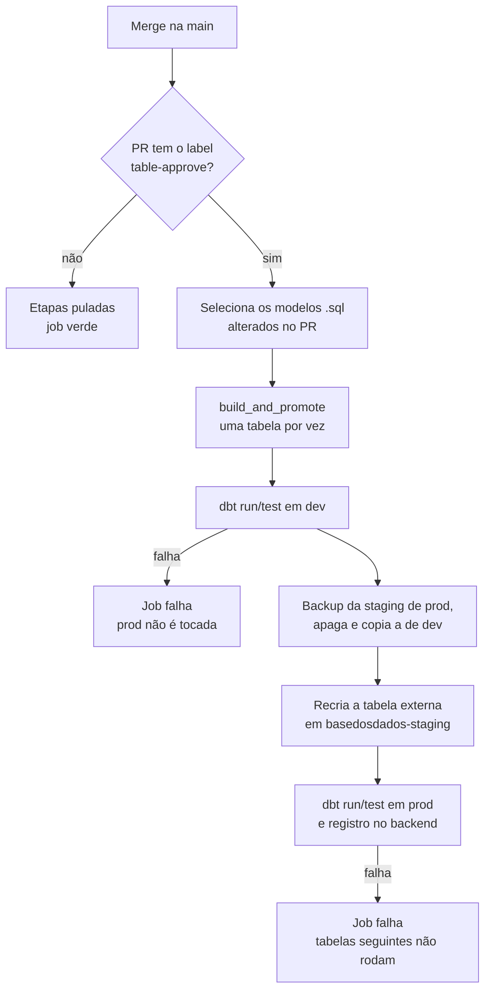

# Table-approve

## Contexto

Os dados são validados em dev (`basedosdados-dev`). Prod (`basedosdados` e
`basedosdados-staging`) não é alterada manualmente: as credenciais existem
apenas no GitHub Actions e nos workers do Prefect.

O `table-approve` leva para prod as tabelas alteradas em um PR do
[`pipelines`](https://github.com/basedosdados/pipelines). Roda no merge para a
`main`, se o PR tiver o label `table-approve`.

## A ideia central

O label não dispara nada ao ser aplicado: o workflow
`.github/workflows/table-approve.yaml` roda em todo push na `main` e só
verifica se o PR tem o label.

```javascript
const approved = labels.data.some(label => label.name === "table-approve");
```

Sem o label, as etapas são puladas e o job fica verde sem materializar nada.
Com ele, a staging de dev vai para prod **no estado em que estiver no merge**.
O label tem que ser aplicado só com a staging de dev completa e final.



O script `.github/workflows/scripts/prefect_run_dbt.py` dispara, para cada
tabela, o deployment `build_and_promote`, o mesmo que as pipelines em estágios
usam ([#2327](https://github.com/basedosdados/pipelines/pull/2327)). Ele espera
cada flow run terminar antes de passar à próxima tabela e imprime a URL do run
no log da Action.

**1. Seleção.** Só entram arquivos `models/<dataset>/<modelo>.sql`; subpastas,
testes e macros ficam de fora. Um prefixo `<dataset>__` no nome do arquivo é
removido para chegar ao `table_id`.

```python
if file.suffix == ".sql" and len(file.parts) == 3 and file.parts[0] == "models"
```

**2. Teste em dev.** O `build_and_promote` roda `dbt run/test --target dev`.
Se falhar, a tabela não é promovida e prod não muda.

**3. Substituição da staging.** O `transfer_files_to_prod_flow` (subflow do
`build_and_promote`) chama `copy_staging_to_prod` sem `folders`, ou seja, uma
promoção completa: copia a staging de prod para `basedosdados-backup`, **apaga**
a staging de prod e copia a de dev inteira, com cópia server-side.

**4. Tabela externa.** `basedosdados-staging.<dataset>_staging.<tabela>` é
recriada com o esquema de **um** arquivo de amostra da staging copiada.

**5. Materialização e registro.** `dbt run/test --target prod` e, em seguida,
o registro da materialização no backend (cobertura e última atualização).

Cada tabela passa pelas etapas 2 a 5 antes da próxima começar. Se uma falhar,
as tabelas anteriores do PR já foram promovidas e as seguintes não rodam.

!!! warning "Staging de dev vazia"
    Com a staging de dev vazia, o backup e a limpeza da staging de prod
    acontecem antes da cópia, e o flow só falha depois (não há arquivo de
    amostra). A staging de prod fica vazia até ser restaurada do backup. Antes
    de aplicar o label, confira que a staging de dev de cada tabela do PR
    existe e está completa.

### Alterações de esquema

A tabela final é recriada a cada execução, então colunas novas ou removidas não
exigem passo extra. O risco está na tabela externa, cujo esquema vem de um
único arquivo: coluna ausente nele gera `Unrecognized name` no `dbt run`.
CSV é lido por posição, e ordem de colunas diferente entre arquivos troca
valores sem erro; Parquet é lido por nome.

## Trade-offs e alternativas consideradas

- **Promoção pela staging de prod, em vez de escrita direta em `basedosdados`:**
  prod recebe só dados validados em dev
  ([ADR-0002](../../infraestrutura/adr/0002-pipeline-integrada-com-ambiente-dev.md)),
  e a staging de prod serve de backup
  ([ADR-0003](../../infraestrutura/adr/0003-manter-staging-no-processo-de-dados.md)).
- **Mesmo deployment das pipelines:** desde o
  [#2327](https://github.com/basedosdados/pipelines/pull/2327), o
  `table-approve` usa o `build_and_promote`, então testa em dev antes de
  promover e roda os testes também em prod. Uma tabela com teste falhando não
  é mais promovida.
- **O que fica de fora:** ordem de dependência entre modelos novos do mesmo
  PR, e promoção parcial (o `table-approve` sempre copia a staging inteira,
  apagando em prod arquivos que só existem lá).
  

## Ver também

- [Abrir um PR](../como-fazer/abrir-pr.md)
- [Fluxo de dados e infraestrutura](../../onboarding/fluxo-de-dados-e-infraestrutura.md)
