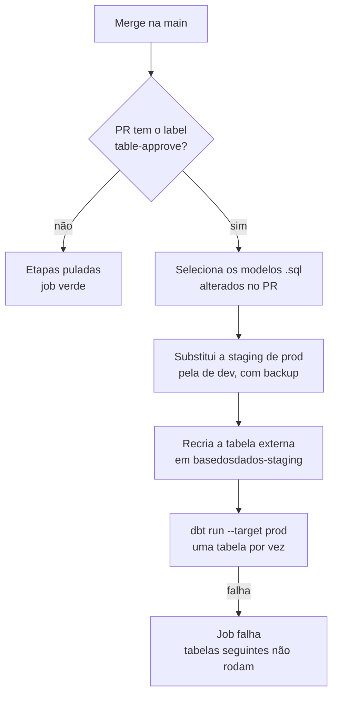

# Table-approve

## Contexto

Os dados são validados em dev (`basedosdados-dev`). Prod (`basedosdados` e
`basedosdados-staging`) não é alterada manualmente: as credenciais existem
apenas no GitHub Actions e nos workers do Prefect.

O `table-approve` leva para prod as tabelas alteradas em um PR do
[`pipelines`](https://github.com/basedosdados/pipelines). Roda no merge para a
`main`, se o PR tiver o label `table-approve`.

## A ideia central

O label não dispara nada ao ser aplicado: o workflow
`.github/workflows/table-approve.yaml` roda em todo push na `main` e só
verifica se o PR tem o label.

```javascript
const approved = labels.data.some(label => label.name === "table-approve");
```

Sem o label, as etapas são puladas e o job fica verde sem materializar nada.
Com ele, a staging de dev vai para prod **no estado em que estiver no merge**.
Aplique o label só com a staging de dev completa e final.



As etapas estão em `.github/workflows/scripts/prefect_run_dbt.py` (trechos
reduzidos abaixo).

**1. Seleção.** Só entram arquivos `models/<dataset>/<modelo>.sql`; subpastas,
testes e macros ficam de fora.

```python
if file.suffix == ".sql" and len(file.parts) == 3 and file.parts[0] == "models"
```

**2. Substituição da staging.** A staging de prod vai para
`basedosdados-backup` e é trocada pela de dev. Se a de dev estiver vazia, nada
muda.

```python
if len(list(source_ref)) == 0:  # staging de dev vazia
    return True
ref.copy_table(source_bucket_name=destination_bucket_name,  # prod -> backup
               destination_bucket_name=backup_bucket_name)
ref.copy_table(source_bucket_name=source_bucket_name,  # dev -> prod
               destination_bucket_name=destination_bucket_name)
```

**3. Tabela externa.** `basedosdados-staging.<dataset>_staging.<tabela>` é
recriada com o esquema do primeiro arquivo da staging de dev.

```python
if blob_name.endswith((".csv", ".parquet")):
    break  # usa só o primeiro arquivo
```

**4. Materialização.** Um flow do Prefect por tabela executa
`dbt run --target prod` e exporta o CSV de download. Uma falha encerra o job.

```python
run_deployment(name=DBT_MODEL_DEPLOYMENT,
               parameters={"dbt_command": "run", "target": "prod", ...})
```

As etapas 2 e 3 rodam para todas as tabelas antes da 4. Se a materialização
falhar, a staging de prod de todo o PR já foi trocada.

### Alterações de esquema

A tabela final é recriada a cada execução, então colunas novas ou removidas não
exigem passo extra. O risco está na tabela externa, cujo esquema vem do
primeiro arquivo: coluna ausente nele gera `Unrecognized name` no `dbt run`.
CSV é lido por posição, e ordem de colunas diferente entre arquivos troca
valores sem erro; Parquet é lido por nome.

## Trade-offs e alternativas consideradas

- **Promoção pela staging de prod, em vez de escrita direta em `basedosdados`:**
  prod recebe só dados validados em dev
  ([ADR-0002](../../infraestrutura/adr/0002-pipeline-integrada-com-ambiente-dev.md)),
  e a staging de prod serve de réplica e backup informal
  ([ADR-0003](../../infraestrutura/adr/0003-manter-staging-no-processo-de-dados.md)).
- **O que fica de fora:** testes dbt, metadados no backend e ordem de
  dependência entre modelos novos do mesmo PR. Há um único backup por tabela,
  sobrescrito a cada execução.
- **Alternativa:** o workflow manual `promote-staging` cobre stagings com nome
  diferente da tabela e materializa o dataset inteiro em ordem de dependências.

## Ver também

- [Abrir um PR](../como-fazer/abrir-pr.md)
- [Fluxo de dados e infraestrutura](../../onboarding/fluxo-de-dados-e-infraestrutura.md)
