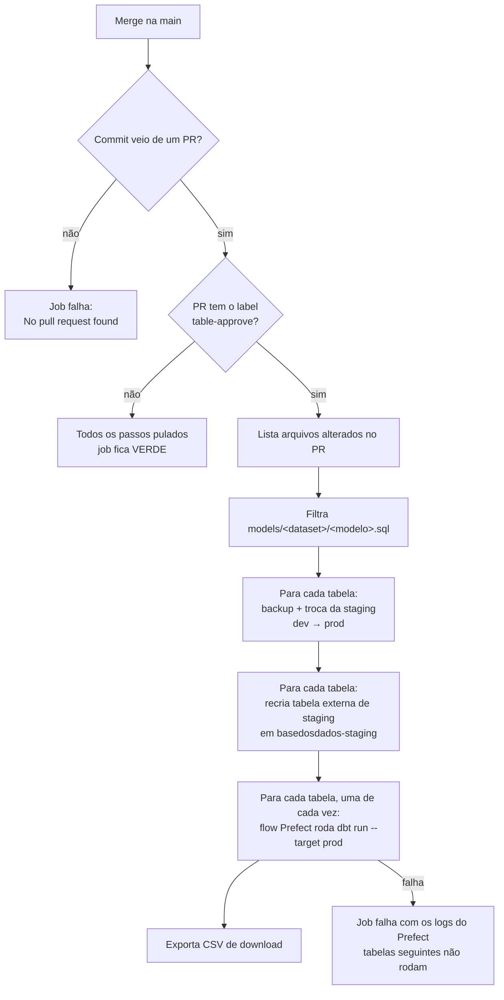

# Table-approve

## Contexto

Os dados de uma tabela são preparados e validados na zona de dev
(`basedosdados-dev`). A zona de prod (`basedosdados` e `basedosdados-staging`)
não é alterada manualmente: as credenciais de prod existem apenas no GitHub
Actions e nos workers do Prefect.

O `table-approve` é o mecanismo que leva para prod as tabelas alteradas em um
PR do repositório [`pipelines`](https://github.com/basedosdados/pipelines). Ele é
executado no merge para a `main`, desde que o PR possua o label
`table-approve`, e substitui a staging de prod pela de dev antes de
materializar cada tabela com o dbt.

## A ideia central

### Momento de uso no desenvolvimento

O label é a última etapa antes do merge. Seu efeito ocorre apenas no merge,
mas ele copia para prod a staging de dev **no estado em que ela estiver
naquele momento**. Por isso, deve ser aplicado somente quando nada mais vai
mudar em dev.

| Fase do PR | Atividade | Label |
|---|---|---|
| Desenvolvimento | Carga da staging em dev, escrita dos modelos dbt, `dbt run` e `dbt test` em dev | Não aplicar |
| PR aberto | `test-dev-model`, `check-metadata` e, em PRs de pipeline, `deploy-flow` | Não aplicar |
| Revisão | Ajustes de código, dados ou modelos solicitados na revisão | Não aplicar |
| Pronto para merge | PR aprovado, staging de dev final e completa, metadados registrados no backend de prod | **Aplicar** |
| Merge | Execução do table-approve | Aplicado |
| Após o merge | Verificação das tabelas em prod e publicação do dataset | — |

O label é necessário apenas quando o PR altera algum arquivo
`models/<dataset>/<modelo>.sql` e a tabela correspondente deve ser
reconstruída em prod a partir da staging de dev. PRs que alteram somente
metadados, `schema.yml`, código de pipeline ou documentação não são afetados
pelo processo.

### Funcionamento

1. **Gatilho** (`.github/workflows/table-approve.yaml`). O workflow é
   executado em todo push na `main`. Ele identifica o PR do commit e lê seus
   labels no momento da execução; o label não dispara o processo. Sem o label,
   todas as etapas são ignoradas e o job termina com sucesso.
2. **Seleção das tabelas** (`get_datasets_tables_from_modified_files`). São
   considerados apenas os arquivos alterados, e não removidos, no formato exato
   `models/<dataset>/<modelo>.sql`. O nome do diretório define o dataset, e o
   prefixo `<dataset>__` é removido do nome do arquivo para obter a tabela.
   `.sql` em subdiretórios, `tests-dbt/` e `macros/` são ignorados.
3. **Substituição da staging** (`sync_bucket`). Para cada tabela, a staging de
   prod é copiada para `gs://basedosdados-backup`, removida e substituída pela
   staging de dev. Se a staging de dev estiver vazia, nada é copiado, o log
   registra `TABLE was NOT created` e o processo segue com a staging de prod
   existente.
4. **Recriação da tabela externa** (`save_header_files` e `push_table_to_bq`).
   A tabela `basedosdados-staging.<dataset>_staging.<tabela>` é recriada com
   todas as colunas como STRING. O esquema vem do **primeiro arquivo** do
   prefixo de dev, em ordem alfabética: em CSV, pela consulta
   `SELECT * ... LIMIT 1` à tabela externa de dev; em Parquet, pelas colunas do
   próprio arquivo.
5. **Materialização** (`run_table_approve` e o flow `run_dbt_model_flow`).
   Para cada tabela, sequencialmente, um flow do Prefect executa
   `dbt run --target prod` e exporta o CSV de download. Uma falha encerra o job,
   com os logs de erro do Prefect no log do GitHub Actions, e as tabelas
   seguintes não são processadas.

As funções das etapas 2 a 5 estão em
`.github/workflows/scripts/prefect_run_dbt.py`, exceto o flow, definido em
`pipelines/utils/execute_dbt_model/flows.py`.

As etapas 3 e 4 são executadas para todas as tabelas antes da primeira
materialização.

### Alterações de esquema

Os modelos são materializados como `table`, portanto a tabela final é recriada
a cada execução e incorpora ou remove colunas sem `ALTER TABLE`. O ponto
crítico é a tabela externa de staging, que precisa conter todas as colunas
lidas pelo modelo:

- uma coluna nova ausente da staging de dev, ou presente apenas nos períodos
  recentes, gera `Unrecognized name: <coluna>` no `dbt run`;
- CSVs com ordem de colunas divergente entre períodos são lidos por posição, e
  os valores passam a ocupar colunas erradas **sem gerar erro**. Parquet é lido
  por nome e não tem esse problema.

## Trade-offs e alternativas consideradas

**Justificativa.** O table-approve é a etapa de promoção do fluxo definido no
[ADR-0002](../../infraestrutura/adr/0002-pipeline-integrada-com-ambiente-dev.md):
os dados são testados em dev, e `basedosdados` recebe apenas versões já
validadas, sem correções feitas diretamente em produção. A promoção passa pela
staging de prod, mantida pelo
[ADR-0003](../../infraestrutura/adr/0003-manter-staging-no-processo-de-dados.md)
porque a réplica dos dados em prod funciona como backup informal.

**Limitações.**

- não executa testes dbt; a validação depende do que foi executado em dev;
- não altera metadados no backend, incluindo colunas novas e status do dataset;
- não respeita dependências entre modelos alterados no mesmo PR;
- não processa tabelas cujo `.sql` não foi alterado ou foi removido;
- mantém um único backup por tabela, sobrescrito a cada execução;
- promove a staging de dev no estado em que ela estiver no merge; como dev é
  compartilhado, uma regravação posterior à validação vai para prod sem aviso.

**Alternativa.** O workflow manual `promote-staging` atende os casos em que a
staging tem nome diferente da tabela publicada e permite materializar o dataset
inteiro em ordem de dependências.

??? tip "Analogia"
    Um garçom (o workflow) leva ao salão (prod) apenas os pratos com carimbo da
    chef (o label). Para cada receita alterada (o modelo dbt), ele troca a
    prateleira inteira do salão pela da cozinha de testes (a staging de dev) e
    confere o conteúdo pela etiqueta da primeira caixa (o esquema do primeiro
    arquivo). Etiqueta desatualizada impede o preparo; o que não estava na
    cozinha de testes deixa de existir no salão.

## Ver também

- [Abrir um PR](../como-fazer/abrir-pr.md)
- [Fluxo de dados e infraestrutura](../../onboarding/fluxo-de-dados-e-infraestrutura.md)
